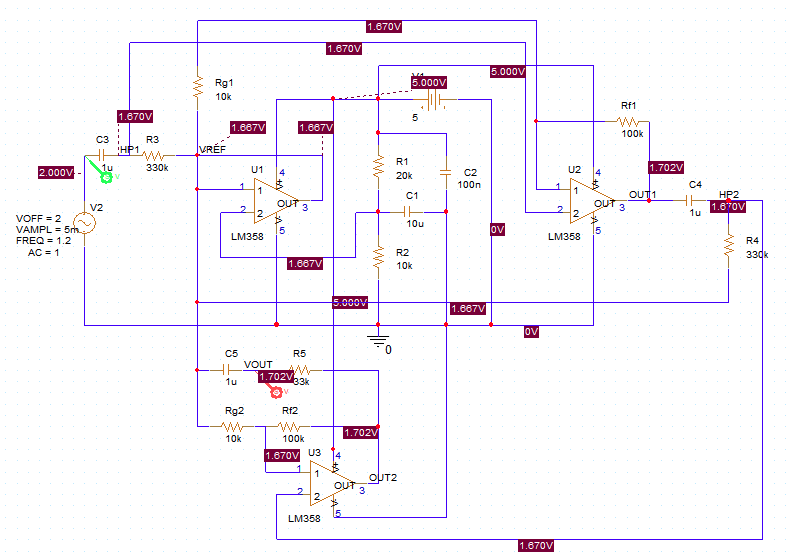
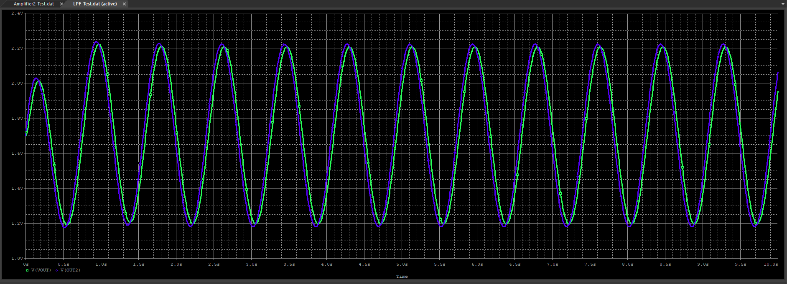
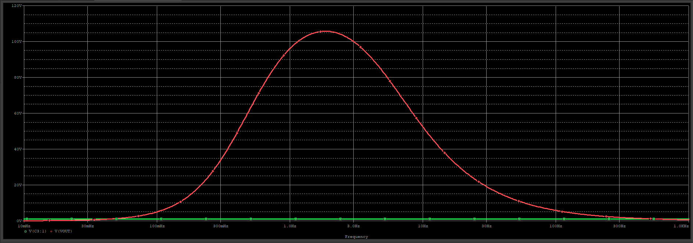
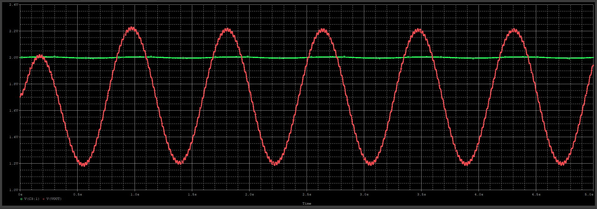
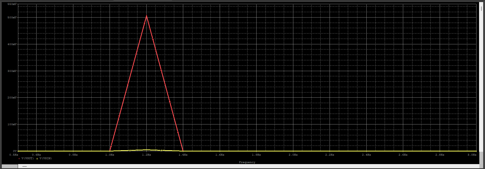
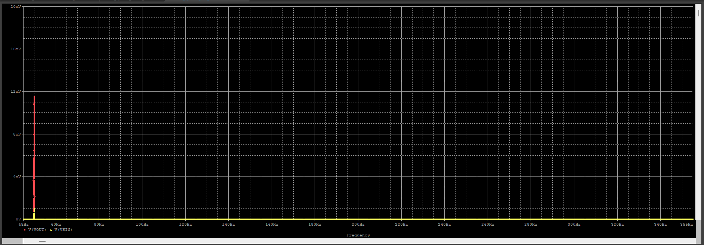

# PPG Analog Front-End

### LM358-Based Analog Signal Conditioning for Photoplethysmography

Design and simulation of an analog front-end (AFE) for photoplethysmography (PPG) signal acquisition using LM358 operational amplifiers and passive RC filters.

The circuit is designed to amplify low-amplitude PPG signals, attenuate unwanted DC components, and reduce high-frequency interference.

This project focuses on **analog circuit design, SPICE simulation, and experimental hardware verification**, without relying on microcontrollers or digital signal processing.

**Project Status:** Simulation Completed | Hardware Implementation Planned

---

## 1. Project Overview

Photoplethysmography (PPG) is an optical sensing technique that detects changes in blood volume by measuring variations in transmitted or reflected light.

A typical PPG signal contains a small pulsatile AC component superimposed on a relatively large DC component. Noise and interference can make direct measurement difficult.

To condition the signal, this project implements an analog front-end consisting of:

- **High-Pass Filters (HPFs):** Remove DC components and attenuate low-frequency variations.
- **Non-Inverting Amplifiers:** Amplify the low-amplitude pulsatile signal.
- **Low-Pass Filter (LPF):** Attenuate high-frequency interference.
- **Voltage Reference Buffer:** Establish a stable bias voltage for single-supply operation.

The final objective is to build the circuit using discrete components and observe a real PPG waveform from a KY-039 optical pulse sensor using an oscilloscope.

## 2. System Architecture

The signal-processing chain consists of two RC high-pass filters, two LM358 non-inverting amplifier stages, and one RC low-pass filter.

**Signal Flow:**

```text
PPG Sensor (KY-039)
        |
        v
High-Pass Filter 1
  fc = 0.482 Hz
        |
        v
Non-Inverting Amplifier 1
     Gain = 11
        |
        v
High-Pass Filter 2
  fc = 0.482 Hz
        |
        v
Non-Inverting Amplifier 2
     Gain = 11
        |
        v
 Low-Pass Filter
  fc = 4.823 Hz
        |
        v
       VOUT
        |
        v
   Oscilloscope
```

A separate LM358 voltage follower generates a buffered reference voltage for the analog signal-processing stages.

### Complete Circuit Schematic



*Figure 1. Complete PPG analog front-end designed in PSpice for TI, including the voltage reference, two HPFs, two amplifier stages, and an LPF.*

### Design Specifications

| Parameter | Value |
|---|---|
| Supply Voltage | 5 V DC |
| Operational Amplifier | LM358 |
| Reference Voltage | Approximately 1.667 V |
| HPF1 Cutoff Frequency | 0.482 Hz |
| Amplifier 1 Gain | 11 V/V |
| HPF2 Cutoff Frequency | 0.482 Hz |
| Amplifier 2 Gain | 11 V/V |
| LPF Cutoff Frequency | 4.823 Hz |
| Nominal Cascaded Amplifier Gain | 121 V/V |
| Intended PPG Sensor | KY-039 |
| Output Measurement | Oscilloscope |

The actual overall gain depends on the signal frequency because of the high-pass and low-pass filter responses.

---

## 3. Analog Circuit Design

### 3.1 Voltage Reference

The circuit operates from a single 5 V power supply.

A voltage divider consisting of $R_1 = 20\,k\Omega$ and $R_2 = 10\,k\Omega$ generates the reference voltage.

$$
V_{REF}=V_{CC}\frac{R_2}{R_1+R_2}
$$

$$
V_{REF}=5\frac{10k}{20k+10k}
\approx1.667\,V
$$

An LM358 voltage follower buffers the reference voltage, providing a low-output-impedance bias source for subsequent stages.

**Simulation Result:** $V_{REF}=1.666742\,V$

### 3.2 High-Pass Filters

Two first-order RC high-pass filters are used to attenuate DC components and low-frequency variations.

Each filter consists of:

| Component | Value |
|---|---|
| Resistor | 330 kΩ |
| Capacitor | 1 µF |

The cutoff frequency is calculated as:

$$
f_{c,HPF}=\frac{1}{2\pi RC}
$$

$$
f_{c,HPF}
=\frac{1}{2\pi(330k)(1\mu F)}
\approx0.482\,Hz
$$

At 1.2 Hz, each filter has an ideal amplitude transmission of approximately 92.8%.

The second HPF also attenuates the DC offset introduced by the first amplifier stage before further amplification.

Both filters are biased relative to $V_{REF}$ rather than ground.

### 3.3 Non-Inverting Amplifiers

Two non-inverting LM358 amplifier stages are used to amplify the PPG signal.

Each stage uses:

| Component | Value |
|---|---|
| Feedback Resistor | 100 kΩ |
| Gain Resistor | 10 kΩ |

The nominal closed-loop gain is:

$$
A_v=1+\frac{R_f}{R_g}
$$

$$
A_v=1+\frac{100k}{10k}=11
$$

The nominal gain of the two cascaded amplifier stages is:

$$
A_{v,amp}=11\times11=121
$$

However, the total AFE gain at 1.2 Hz is lower due to attenuation from the analog filters.

### 3.4 Low-Pass Filter

A first-order passive RC low-pass filter is used at the output stage.

| Component | Value |
|---|---|
| Resistor | 33 kΩ |
| Capacitor | 1 µF |

Its cutoff frequency is:

$$
f_{c,LPF}=\frac{1}{2\pi RC}
$$

$$
f_{c,LPF}
=\frac{1}{2\pi(33k)(1\mu F)}
\approx4.823\,Hz
$$

The LPF preserves most of the 1.2 Hz signal while attenuating higher-frequency components.

Together, the two HPFs and one LPF produce a band-pass-shaped frequency response.

---

## 4. Simulation Environment

The circuit was designed and verified using **PSpice for TI 23.1**.

| Item | Configuration |
|---|---|
| Simulation Software | PSpice for TI 23.1 |
| Op-Amp Model | STMicroelectronics LM358 |
| Supply Voltage | 5 V DC |
| Simulation Types | Transient, AC Sweep, FFT |
| Input Signal | Simulated PPG waveform |

An external LM358 SPICE model and a custom schematic symbol were configured for simulation.

### 4.1 Simulated PPG Signal

Before physical sensor testing, a sinusoidal source was used to simulate the pulsatile component of a PPG signal.

$$
V_{IN}(t)=2+0.005\sin(2\pi\cdot1.2t)
$$

| Parameter | Value |
|---|---|
| DC Offset | 2 V |
| AC Amplitude | 5 mV peak |
| Peak-to-Peak Amplitude | 10 mV |
| Frequency | 1.2 Hz |
| Equivalent Heart Rate | 72 BPM |

This test signal is generated by an ideal voltage source and is not an experimentally acquired PPG waveform.

### 4.2 Simulation Procedure

The circuit was validated incrementally before full-system integration.

1. Voltage reference generation
2. First high-pass filter
3. First amplification stage
4. Second high-pass filter
5. Second amplification stage
6. Output low-pass filter
7. Complete AFE transient response
8. AC frequency response
9. 50 Hz interference test
10. FFT analysis

---

## 5. Simulation Results

### 5.1 Stage-by-Stage Verification

Each circuit stage was verified independently using transient simulation.

| Stage | Simulation Result |
|---|---|
| Voltage Reference | 1.666742 V |
| HPF1 | Approximately 92.8% transmission at 1.2 Hz |
| Amplifier 1 | Approximately 11× gain |
| HPF2 | Approximately 92.8% transmission at 1.2 Hz |
| Amplifier 2 | Approximately 11× gain |
| LPF | Approximately 97.0% transmission at 1.2 Hz |

The results were consistent with the theoretical RC filter characteristics and non-inverting amplifier gain equations.

### 5.2 Complete AFE Transient Response

For a 1.2 Hz input with a 5 mV peak amplitude, the complete circuit produced an output amplitude of approximately 505 mV peak.

| Parameter | Input | Output |
|---|---:|---:|
| Signal Frequency | 1.2 Hz | 1.2 Hz |
| AC Amplitude | 5 mV peak | 505.35 mV peak |
| Peak-to-Peak Voltage | 10 mV | 1.0107 V |
| Voltage Gain | — | Approximately 101.07× |

The circuit amplified the simulated PPG signal while preserving its sinusoidal waveform.

**Transient Simulation**



*Figure 2. Transient response comparing the simulated PPG input and the final analog front-end output.*

The simulated output DC level was approximately 1.702 V, slightly higher than the 1.667 V reference voltage.

This deviation is consistent with the influence of non-ideal operational amplifier characteristics, including input bias currents and offset effects.

### 5.3 AC Sweep Analysis

An AC sweep was performed from 0.01 Hz to 1 kHz to analyze the frequency response of the complete circuit.

| Frequency | Voltage Gain | Linear Gain |
|---|---:|---:|
| 1.2 Hz | 40.092 dB | 101.07× |
| 1.862 Hz | 40.486 dB | 105.76× |
| 50 Hz | 21.299 dB | 11.61× |

The maximum simulated gain occurred near 1.862 Hz.

The result demonstrates a band-pass-shaped frequency response produced by the combined HPF and LPF stages.

**AC Frequency Response**



*Figure 3. AC sweep showing the voltage gain of the complete PPG analog front-end across frequency.*

For the idealized RC stages and amplifier gains, the overall magnitude response can be approximated as:

$$
|H(f)|=
121
\left(
\frac{f}{\sqrt{f^2+f_{c,HPF}^2}}
\right)^2
\frac{1}{\sqrt{1+(f/f_{c,LPF})^2}}
$$

At 1.2 Hz, the theoretical overall gain is approximately 101×, closely matching the simulation result.

### 5.4 50 Hz Interference Test

A 50 Hz sinusoidal interference component was added to the simulated PPG signal.

$$
V_{IN}(t)=
2+
0.005\sin(2\pi\cdot1.2t)+
0.001\sin(2\pi\cdot50t)
$$

| Signal Component | Frequency | Input Amplitude |
|---|---:|---:|
| Simulated PPG | 1.2 Hz | 5 mV peak |
| Interference | 50 Hz | 1 mV peak |

The purpose of this test was to evaluate how the analog front-end responds to a high-frequency interference component relative to the desired PPG signal.

**Transient Response with 50 Hz Interference**



*Figure 4. Time-domain response of the analog front-end with a 50 Hz interference component added to the simulated PPG input.*

### 5.5 FFT Analysis

FFT analysis was performed to compare the 1.2 Hz and 50 Hz frequency components at the input and output.

The steady-state interval from 5 s to 10 s was used for the FFT analysis.

| Frequency Component | Input Amplitude | Output Amplitude |
|---|---:|---:|
| 1.2 Hz PPG Signal | 5.00015 mV | 505.357 mV |
| 50 Hz Interference | 0.99970 mV | 11.607 mV |

**FFT — 1.2 Hz Signal**



*Figure 5. FFT spectrum near 1.2 Hz showing the amplified PPG signal component.*

**FFT — 50 Hz Interference**



*Figure 6. FFT spectrum near 50 Hz showing the remaining interference component.*

#### Relative Interference Rejection

The interference-to-signal amplitude ratio was evaluated before and after analog conditioning.

| Measurement | Input | Output |
|---|---:|---:|
| 50 Hz / 1.2 Hz Amplitude Ratio | 19.993% | 2.297% |
| Relative Interference Level | −13.982 dB | −32.778 dB |

The relative interference rejection is:

$$
\Delta SIR =
20\log_{10}
\left(
\frac{
A_{1.2,out}/A_{50,out}
}{
A_{1.2,in}/A_{50,in}
}
\right)
$$

$$
\boxed{\Delta SIR\approx18.796\,dB}
$$

The 50 Hz component was not eliminated, and its absolute voltage amplitude increased after amplification.

However, its amplitude relative to the desired 1.2 Hz signal decreased from approximately 20.0% to 2.3%.

This represents an approximately **18.8 dB improvement in the signal-to-interference ratio** for the two simulated sinusoidal components. It is not a measurement of broadband noise performance.

---

## 6. Hardware Implementation

The next phase is to construct the complete analog front-end using physical components and compare its measured performance with the simulation results.

### Planned Hardware

| Component | Purpose |
|---|---|
| KY-039 PPG Sensor | Optical pulse sensing |
| LM358N (2 ICs) | Reference buffering and signal amplification |
| Resistors and Capacitors | RC filtering and gain control |
| Breadboard | Circuit prototyping |
| Regulated 5 V Supply | Circuit power |
| Digital Multimeter | DC voltage and continuity measurements |
| Oscilloscope | Analog waveform measurement |

The two LM358N ICs provide four operational amplifier channels. Three channels are used for reference buffering and signal amplification; the remaining channel will be configured safely as an unused voltage follower.

### Hardware Verification Procedure

1. **Sensor Characterization:** Measure the actual DC level and AC variation of the KY-039 output.
2. **Voltage Reference:** Construct and verify the 1.667 V reference buffer.
3. **First Filtering and Amplification:** Implement HPF1 and the first LM358 amplifier stage.
4. **Second Filtering and Amplification:** Add HPF2 and the second amplification stage.
5. **Output Filtering:** Implement the final RC low-pass filter.
6. **Waveform Measurement:** Observe the conditioned PPG signal using an oscilloscope.
7. **Experimental Comparison:** Compare actual waveforms and measured gains with simulation predictions.

The circuit will be constructed and verified incrementally to isolate potential hardware issues.

**The project uses analog signal conditioning only. No microcontroller, Arduino, or digital signal-processing stage is required.**

---

## 7. Current Limitations

The analog circuit has been validated through PSpice simulation, but physical hardware measurements have not yet been completed.

The current simulation does not establish:

- Actual KY-039 sensor output amplitude or DC level
- Performance under motion artifacts and ambient light variations
- Hardware noise and electromagnetic interference
- Effects of component tolerances and breadboard parasitics
- Exact performance of physical LM358N devices
- Absence of output saturation under real sensor conditions
- Successful acquisition of a real PPG waveform from a finger

These factors will be evaluated during hardware implementation.

---

## 8. Repository Structure

The repository contains the original PSpice project, simulation settings, and documented results.

```text
PPG-Analog-Front-End/
│
├── README.md
├── .gitignore
│
├── PPG_Analog_Front_End.opj
├── PPG_ANALOG_FRONT_END.DSN
│
├── PPG_Analog_Front_End-PSpiceFiles/
│   └── [PSpice simulation profiles]
│
└── images/
    ├── full_circuit.png
    ├── transient_response.png
    ├── ac_sweep.png
    ├── noise_test.png
    ├── fft_1p2hz.png
    └── fft_50hz.png
```

*The `images/` directory contains selected schematic and simulation figures for documentation. Generated simulation data and temporary files are generally excluded from version control.*

### External LM358 SPICE Model

The project uses an external STMicroelectronics LM358 SPICE model and a custom PSpice schematic symbol.

These files are referenced from a separate library directory in the original Windows development environment.

To reproduce the simulations on another computer:

1. Obtain the appropriate LM358 SPICE model from its authorized source.
2. Configure the corresponding PSpice schematic symbol.
3. Update the library paths in the simulation and schematic settings.
4. Verify the model pin mapping before running the simulations.

Third-party library files should only be redistributed when permitted by their license terms.

---

## 9. Project Progress

### Completed

- [x] PPG analog front-end architecture
- [x] Voltage reference circuit design
- [x] HPF and LPF component calculations
- [x] Two-stage LM358 amplifier design
- [x] Individual circuit simulations
- [x] Complete circuit transient verification
- [x] AC sweep frequency response analysis
- [x] 50 Hz interference simulation
- [x] FFT-based frequency component analysis

### Planned

- [ ] Breadboard implementation
- [ ] KY-039 sensor characterization
- [ ] Reference voltage hardware verification
- [ ] Stage-by-stage oscilloscope measurements
- [ ] Real PPG waveform acquisition
- [ ] Simulation-to-hardware comparison
- [ ] Final experimental report

---

## 10. Project Significances

This project provides practical experience in:

- Analog bioelectronic circuit design
- Small-signal amplification
- Operational amplifier biasing
- Passive RC filter design
- SPICE-based circuit verification
- Frequency-domain signal analysis
- Experimental circuit debugging and validation

The long-term objective is to strengthen the hardware foundation required for biological signal acquisition and bioelectronic interface development.

---

**Current Stage:** Simulation validated — hardware implementation pending.
